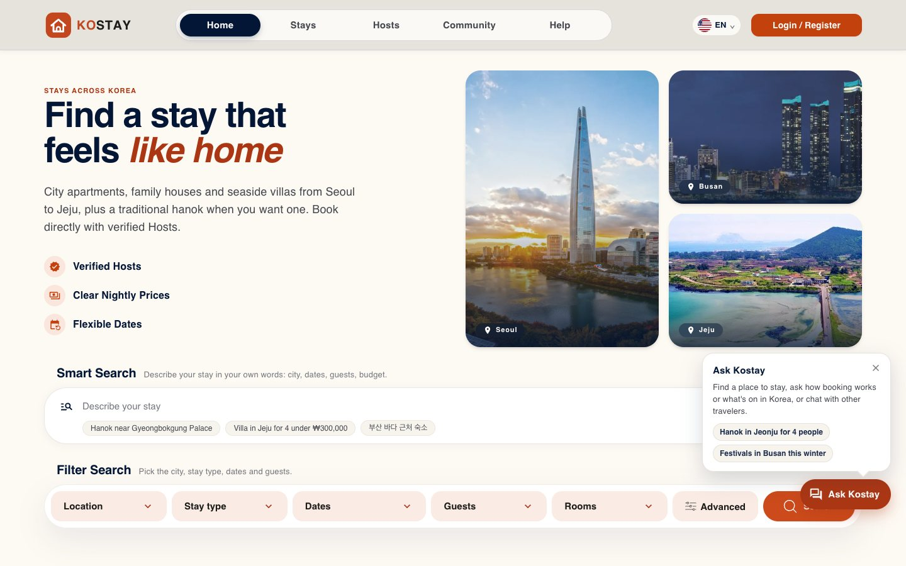
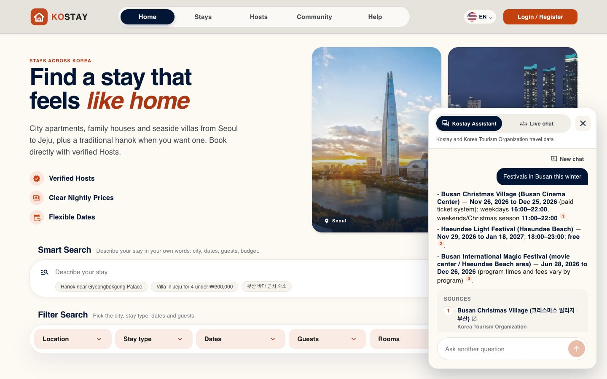
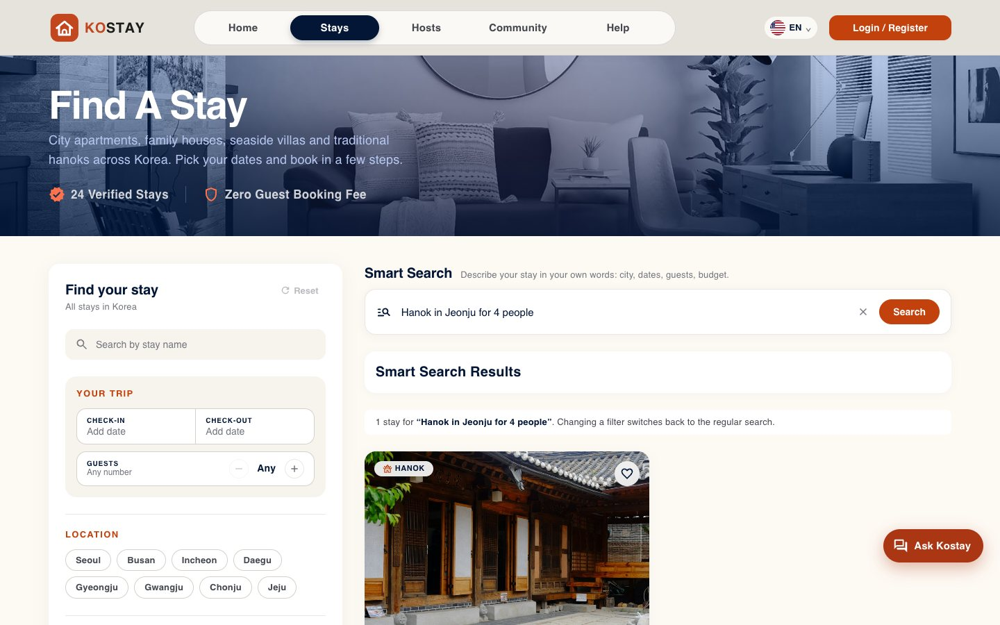
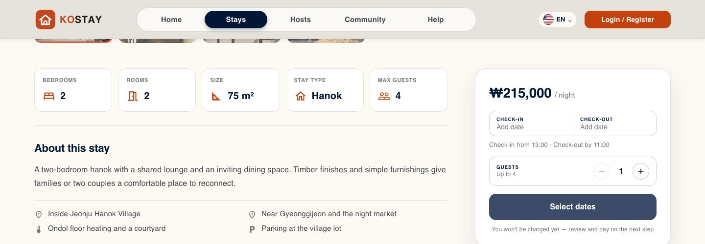
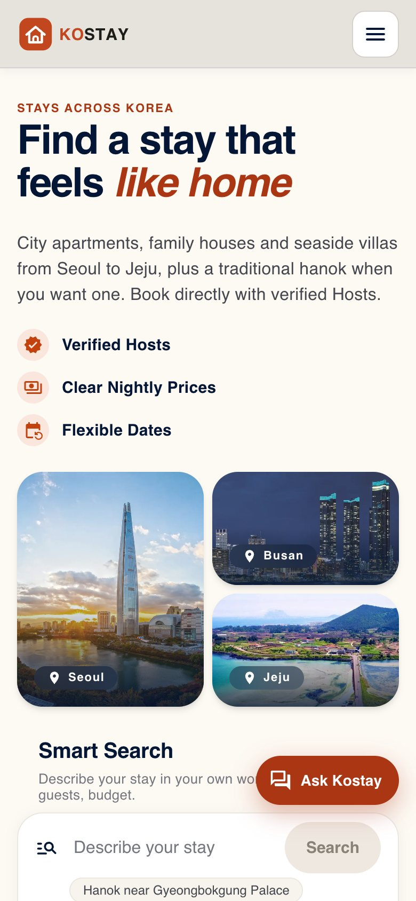

# Kostay Web

The website of [Kostay](https://kostay.kr), a booking platform for stays in South Korea: apartments,
villas, houses and hanoks. Guests find a stay by city and dates or by describing it in their own
words, book it at once and follow their bookings; hosts manage stays and reservations; admins run
the platform from a separate panel.

Built with Next.js and TypeScript. It talks to the
[Kostay API](https://github.com/mryaryyev/kostay) over GraphQL; search in natural language and the
assistant come from [kostay-ai-search](https://github.com/mryaryyev/kostay-ai-search) through that API.



## What a visitor can do

| Area | Pages | What is there |
|---|---|---|
| Home | `/` | Search bar, Smart Search, trending, popular and top stays, top hosts, events, community posts |
| Stays | `/stay`, `/stay/detail` | Filters, sorting and paging; photos, description, reviews and a booking box with a calendar |
| Booking | `/booking/checkout` | Review the stay and the price, choose a payment method, book |
| Hosts | `/host`, `/host/detail` | Host directory, a host's stays and reviews, follow and like |
| Community | `/community`, `/community/detail` | Four boards, articles written in a rich editor, comments and likes |
| Help | `/help` | Notices, FAQ and 1:1 inquiries |
| My page | `/mypage` | Guests: bookings, favorites, recently visited, articles, notifications. Hosts also: stays, new stay, reservations |
| Admin | `/_admin` | Dashboard, members, stays, bookings and refunds, community, help center, AI search metrics |

## Ask Kostay

One button on every page opens a small window with two tabs: the assistant and the live chat.



- **Assistant.** The answer is read from a stream (`fetch` on a POST request, not `EventSource`,
  which can only GET): first "searching", then each sentence as it arrives, then the final answer with
  numbered sources, stay cards and host cards (a question can ask for an answer and stays together). A source link opens the exact FAQ item or notice in the Help Center
  and scrolls to it.
- **Follow-up questions.** Each answer comes back with the question as the assistant understood it;
  the last three of those are sent with the next question, so "and in Seoul?" works.
- **One conversation for the whole site.** The state lives above the page layouts, so the window and
  the conversation survive a page change. Closing the window or starting a new chat cancels the
  request in flight, which also stops the answer on the server.
- **Live chat** uses a plain WebSocket that reconnects with exponential backoff and keeps the messages
  on screen while the server is away.

## Smart Search

A guest writes "Hanok in Jeonju for 4 people" on the home page or the stays page. The stays
page lists the result, lets the guest clear the search, and shows a note when nothing matched every
filter and some were relaxed. The admin panel has a page for its volume, latency, cost and how often
the keyword search had to step in.



## Booking



- The calendar disables past days and nights that are already booked; a check-out day is offered
  only when no booked night lies between it and the chosen check-in.
- Dates are plain `YYYY-MM-DD` strings from the calendar to the API, so no time zone can shift a day.
- The price on the checkout page is a preview; the API calculates the amount that is saved.

## How it is built

- **Pages Router**, one file per route, four layouts (home, basic, full, admin) as higher-order
  components.
- **Apollo Client** for GraphQL: the login token is added to every request, file uploads use an
  upload link, errors are handled in one place.
- **Role-based screens**: the menu and the pages follow the member type (guest, host, admin).
- **Responsive SCSS** with `mobile` and `tablet` mixins; a small hook switches the markup only where
  it really differs on a phone (the menu drawer, the sticky booking bar, the full-screen assistant).
- **MUI** components with a custom theme, Swiper carousels, Toast UI editor for articles.
- The menu is translated into English, Korean and Russian (next-i18next).



## Run locally

You need Node.js 22 and a running [Kostay API](https://github.com/mryaryyev/kostay).

```bash
yarn install
cp .env.example .env.local     # the API addresses
yarn dev                       # http://localhost:3000
```

## Checks

```bash
yarn lint
yarn tsc --noEmit
yarn build
```

CI runs the same three on every pull request.

## Deploy

A multi-stage Docker image builds the standalone Next.js server; the API addresses are passed as
build arguments. On the server:

```bash
./deploy.sh        # pull main, build the new image, swap the container
```

## Project structure

```text
pages/               routes: home, stay, booking, host, community, help, mypage, member, account, _admin
libs/components/     UI by area: homepage, property, mypage, community, cs, admin, assistant, layout, common
libs/hooks/          useAssistant, AssistantContext, useDeviceDetect, useLinkedItem
libs/types, enums/   TypeScript types and enums shared by the pages
apollo/              client, queries and mutations (user, admin), chat socket, reactive store
scss/                variables, mixins, page styles, MUI theme
public/locales/      en, kr, ru
```

## Stack

TypeScript, Next.js 15, React 18, Apollo Client, GraphQL, MUI, SCSS, next-i18next, Swiper,
Toast UI Editor, WebSocket, Docker.
